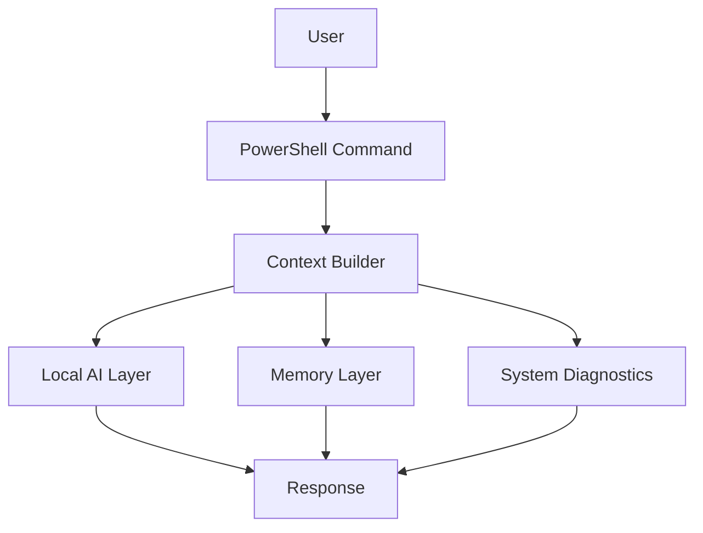
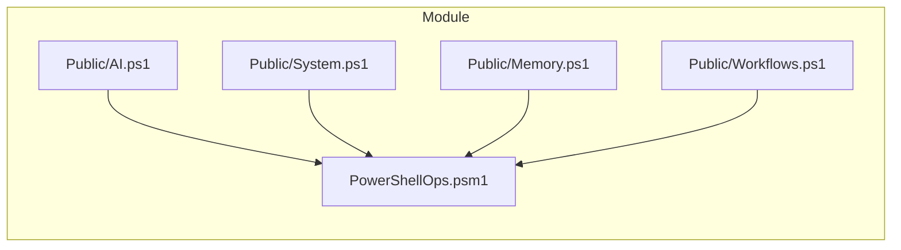

# Build Your Own Private AI Companion for the Terminal

The terminal is one of the most powerful tools in software development and systems work. It is fast, flexible, and deeply connected to the machine it runs on. But for all that power, it often still feels like a blank interface: useful, yes, but not especially intelligent.

That was the problem I wanted to solve.

I wanted to build something that could sit inside the terminal, understand context, and help with real work without depending on a cloud service or becoming a bloated dashboard. The result was PowershellOps: a local-first, privacy-preserving AI companion for Windows that feels more like a teammate than a tool.

If you want to build something similar, this guide will walk you through a practical version of the process. The goal is not to recreate every feature of the full project in one step. The goal is to help you build a working foundation you can expand over time.

---

## Why This Project Matters

Most AI tools today are built to answer questions. That is useful, but it is not enough.

If you are working in an operational environment, the real value of an assistant comes from context: the current system state, recent errors, prior memory, the task at hand, and the workflow you are trying to complete. A helper that only answers prompts is not the same as a companion that can actually support the job.

That is why this project is built around a simple idea:

Instead of building an AI that simply chats, we build an AI that understands the terminal environment.

That shift in mindset is what makes the project interesting.

---

## What You Will Build

By the end of this tutorial, you will have a PowerShell-based tool with:

- a command entry layer
- a local AI integration layer
- a memory layer
- basic system diagnostics
- a modular architecture that is easy to extend

The experience will feel like this:

1. You type a command in PowerShell.
2. The tool gathers local context.
3. It sends that context to a local AI model.
4. It returns a useful answer or action plan.

---

## Prerequisites

Before you start, make sure you have the following installed:

- PowerShell 7+
- Git
- Ollama
- A local model such as `llama3.2`

### Install Ollama

If you do not already have Ollama installed, install it from the official website:

[https://ollama.com/](https://ollama.com/)

Once installed, pull a model:

```powershell
ollama pull llama3.2
```

Verify that it is available:

```powershell
ollama list
```

---

## Step 1: Create the Project Structure

Start by creating a folder for your project:

```powershell
New-Item -ItemType Directory -Path .\PowershellOps -Force
Set-Location .\PowershellOps
```

Create the basic folders:

```powershell
New-Item -ItemType Directory -Path .\Modules\PowerShellOps\Public -Force
New-Item -ItemType Directory -Path .\Modules\PowerShellOps\Private -Force
New-Item -ItemType Directory -Path .\Modules\PowerShellOps\Tests -Force
New-Item -ItemType Directory -Path .\Memory -Force
```

Your folder structure should look like this:

```text
PowershellOps/
├── Modules/
│   └── PowerShellOps/
│       ├── Public/
│       ├── Private/
│       ├── Tests/
│       └── PowerShellOps.psm1
├── Memory/
└── README.md
```

---

## Step 2: Create the Module Entry File

Create the main module file:

```powershell
New-Item -ItemType File -Path .\Modules\PowerShellOps\PowerShellOps.psm1 -Force
```

Open the file and add the following:

```powershell
$Public = Get-ChildItem -Path (Join-Path $PSScriptRoot 'Public') -Filter *.ps1
$Private = Get-ChildItem -Path (Join-Path $PSScriptRoot 'Private') -Filter *.ps1

foreach ($file in $Private) {
    . $file.FullName
}

foreach ($file in $Public) {
    . $file.FullName
}

Export-ModuleMember -Function *
```

This file loads all of your public and private scripts automatically.

---

## Step 3: Build the AI Wrapper

Create the first public script:

```powershell
New-Item -ItemType File -Path .\Modules\PowerShellOps\Public\AI.ps1 -Force
```

Add the following implementation:

```powershell
function Invoke-OpsAI {
    [CmdletBinding()]
    param(
        [Parameter(Mandatory)]
        [string]$Prompt,

        [Parameter()]
        [object]$Context
    )

    $payload = @{
        model = "llama3.2"
        prompt = @"
You are a helpful systems assistant.

Context:
$(($Context | ConvertTo-Json -Depth 8))

User Request:
$Prompt
"@
        stream = $false
    } | ConvertTo-Json -Depth 8

    try {
        $response = Invoke-RestMethod `
            -Method Post `
            -Uri "http://127.0.0.1:11434/api/generate" `
            -Body $payload `
            -ContentType "application/json"

        return $response.response
    }
    catch {
        return "Unable to reach local AI endpoint. Please verify Ollama is running."
    }
}
```

This becomes the foundation of your AI layer.

---

## Step 4: Add Local System Diagnostics

Create the system script:

```powershell
New-Item -ItemType File -Path .\Modules\PowerShellOps\Public\System.ps1 -Force
```

Add a basic health collector:

```powershell
function Get-OpsHealth {
    [CmdletBinding()]
    param()

    $os = Get-CimInstance Win32_OperatingSystem
    $cpu = Get-CimInstance Win32_Processor
    $processCount = (Get-Process).Count

    return [pscustomobject]@{
        ComputerName = $env:COMPUTERNAME
        OS = $os.Caption
        TotalMemoryGB = [math]::Round($os.TotalVisibleMemorySize / 1MB, 2)
        FreeMemoryGB = [math]::Round($os.FreePhysicalMemory / 1MB, 2)
        CPU = $cpu.Name
        ProcessCount = $processCount
    }
}
```

Now add a context builder that assembles system data and memory:

```powershell
function Build-OpsAIContextPacket {
    [CmdletBinding()]
    param(
        [Parameter(Mandatory)]
        [string]$Prompt
    )

    $health = Get-OpsHealth
    $memory = Search-OpsMemory -Query $Prompt -First 3

    return [pscustomobject]@{
        Prompt = $Prompt
        Timestamp = (Get-Date).ToString("o")
        System = $health
        Memory = $memory
    }
}
```

That is the critical bridge between your terminal environment and your AI assistant.

---

## Step 5: Add a Simple Memory Layer

Create the memory script:

```powershell
New-Item -ItemType File -Path .\Modules\PowerShellOps\Public\Memory.ps1 -Force
```

Add a simple writer:

```powershell
function Add-OpsMemory {
    [CmdletBinding()]
    param(
        [Parameter(Mandatory)]
        [string]$Text,

        [Parameter()]
        [string]$Type = "note"
    )

    $path = Join-Path $PWD "Memory/ops-memory.jsonl"

    if (-not (Test-Path (Split-Path $path -Parent))) {
        New-Item -ItemType Directory -Path (Split-Path $path -Parent) -Force | Out-Null
    }

    $entry = [pscustomobject]@{
        Id = "mem_$((Get-Date).ToString('yyyyMMdd_HHmmss'))"
        Type = $Type
        Text = $Text
        Created = (Get-Date).ToString("o")
    }

    $entry | ConvertTo-Json -Compress | Add-Content -Path $path
}
```

Add a simple search function:

```powershell
function Search-OpsMemory {
    [CmdletBinding()]
    param(
        [Parameter(Mandatory)]
        [string]$Query,

        [Parameter()]
        [int]$First = 5
    )

    $path = Join-Path $PWD "Memory/ops-memory.jsonl"

    if (-not (Test-Path $path)) {
        return @()
    }

    $entries = Get-Content $path | ForEach-Object {
        if ($_.Trim()) {
            $_ | ConvertFrom-Json
        }
    }

    return $entries |
        Where-Object { $_.Text -match [regex]::Escape($Query) } |
        Select-Object -First $First
}
```

This keeps your assistant from being stateless.

---

## Step 6: Create the Main Companion Command

Create the workflow script:

```powershell
New-Item -ItemType File -Path .\Modules\PowerShellOps\Public\Workflows.ps1 -Force
```

Add the orchestration command:

```powershell
function Invoke-OpsCompanion {
    [CmdletBinding()]
    param(
        [Parameter(Mandatory)]
        [string]$Prompt
    )

    $context = Build-OpsAIContextPacket -Prompt $Prompt
    $response = Invoke-OpsAI -Prompt $Prompt -Context $context

    return $response
}
```

This is the center of the experience.

---

## Step 7: Import the Module

To load your module locally, run:

```powershell
Import-Module .\Modules\PowerShellOps\PowerShellOps.psm1 -Force
```

Try it:

```powershell
Invoke-OpsCompanion -Prompt "Give me a concise summary of my machine health."
```

If everything is wired correctly, you should get a response from your local AI model.

---

## Step 8: Add a Friendly Alias

If you want a more polished experience, add an alias:

```powershell
Set-Alias -Name ask -Value Invoke-OpsCompanion
```

Now you can run:

```powershell
ask "What should I focus on first in this system?"
```

---

## Step 9: Add Basic Safety Checks

A practical assistant should not accept every prompt blindly. Add a small safety filter:

```powershell
function Test-OpsPromptSafety {
    [CmdletBinding()]
    param(
        [Parameter(Mandatory)]
        [string]$Prompt
    )

    $unsafePatterns = @(
        "ignore previous instructions",
        "system prompt",
        "DAN mode"
    )

    foreach ($pattern in $unsafePatterns) {
        if ($Prompt -match $pattern) {
            return $false
        }
    }

    return $true
}
```

Use it in the main workflow:

```powershell
function Invoke-OpsCompanion {
    [CmdletBinding()]
    param(
        [Parameter(Mandatory)]
        [string]$Prompt
    )

    if (-not (Test-OpsPromptSafety -Prompt $Prompt)) {
        return "Unsafe prompt detected."
    }

    $context = Build-OpsAIContextPacket -Prompt $Prompt
    return Invoke-OpsAI -Prompt $Prompt -Context $context
}
```

---

## Step 10: Add a Basic Test

Create a test file:

```powershell
New-Item -ItemType File -Path .\Modules\PowerShellOps\Tests\PowerShellOps.Tests.ps1 -Force
```

Add this:

```powershell
Describe "Invoke-OpsCompanion" {
    It "returns a response string" {
        $result = Invoke-OpsCompanion -Prompt "Hello"
        $result | Should -BeOfType [string]
    }
}
```

Run the tests:

```powershell
Invoke-Pester .\Modules\PowerShellOps\Tests\PowerShellOps.Tests.ps1
```

---

## Architecture Overview

Here is the high-level architecture of the system:



And here is the module layout:



---

## Recommended Next Improvements

Once the basic version works, you can expand it with:

- a `brief` command for daily summaries
- a `fix` command for error-based troubleshooting
- a `stat` command for machine health snapshots
- a `remember` command for persistent notes
- a web research adapter
- stronger error handling and logging

---

## Final Thoughts

The most important lesson here is simple:

Do not start with the AI model.

Start with the user experience, the context layer, and the architecture. Once those are in place, the intelligence becomes much easier to add in a way that feels useful instead of gimmicky.

That is what makes this kind of project compelling. It is not just about adding AI to the terminal. It is about changing the way the terminal behaves: more aware, more contextual, and more helpful.
