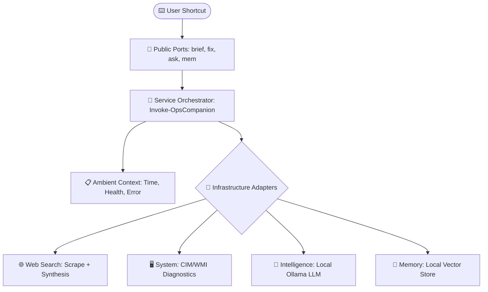

# PowershellOps ⚡ — Universal AI Companion for Windows

> **Advanced Operational Intelligence & Universal AI Companion for Windows.**
> Private. High-Performance. Local Agentic Stack. 81 utility tools · 7
> operational workflows · zero cloud dependencies. 🛡️

[](https://github.com/shahriarhaqueabir/PowershellOps/actions/workflows/ci.yml)
[](#)
[-8A2BE2?logo=ollama&logoColor=white>)](#)
[](#)
[](#)

---

## 🎬 The story — why this exists

Modern IT ops tooling is fragmented and cloud-dependent: Task Manager,
PowerShell, `netsh`, Wireshark, Docker Desktop, kubectl, Defender consoles, and
a browser full of SaaS dashboards — each phoning home, each with its own auth.
At 2 AM on an air-gapped network you need answers _now_, not a login screen.
PowershellOps collapses that stack into one **agentic PowerShell environment**:
81 tools, 7 workflows, a local AI hub, and zero cloud. ⚡

> 💡 **The one sentence that drove everything:** _Transform the terminal from a
> command shell into an intelligent companion that reasons over local context._

---

## 🔁 The feedback loop (zero → finished)

```
  1. 📥 INPUT      user shortcut or pipeline data
  2. 🧠 CONTEXT    inject time, date, system load, last error
  3. 🤖 REASON     local LLM (Ollama) analyzes with grounded context
  4. 🔧 ACTION     propose remediation → human confirms
  5. 📓 AUDIT      secretmask redacts tokens; result logged locally
  6. 🔁 REPEAT     next command, next incident
```

> 🧠 **Secret of the loop:** every AI change is a proposal. `secretmask`
> redacts sensitive tokens before anything is processed or logged.

---

## 🏗️ Architecture — how the pieces talk



| Component         | Responsibility                                | Key location          |
| ----------------- | --------------------------------------------- | --------------------- |
| 🚪 Ports          | Public shortcuts (brief, fix, ask, mem, stat) | `Invoke-OpsCompanion` |
| 🎯 Orchestrator   | Routes to adapters, injects context           | `src/`                |
| 🖥️ System adapter | CIM/WMI diagnostics, health, specs            | `src/sysops/`         |
| 🌐 Web adapter    | Scrape + synthesis (local)                    | `src/web/`            |
| 🤖 AI adapter     | Ollama LLM reasoning                          | `src/ai/`             |
| 🧠 Memory adapter | Local vector store for notes                  | `src/memory/`         |
| 🛡️ Security       | Firewall, defender, port audit, threat hunt   | `src/secops/`         |

---

## 🏆 Good choices (and why they were good)

1. **🏠 Local-first.** No telemetry, no cloud logging. LLM ops via local
   Ollama only.
2. **🛡️ Security substrate.** Local auditing of firewalls, listeners,
   persistence vectors. `secretmask` redacts tokens.
3. **📦 Thin core.** Minimalist architecture, zero meta-bloat, 81 tools.
4. **⚡ Hexagonal design.** Ports & adapters for portability and low latency.
5. **🧠 Situational awareness.** Time, date, system load injected into every
   AI query automatically.
6. **🔄 Self-healing.** `fix` analyzes the last error and proposes remediation.

---

## 📋 The playbook — recreate from zero

### Phase 0 — Scope 🎯

1. One sentence: _"Transform the terminal into an intelligent companion."_
2. Boundaries: 100% local, no cloud, privacy-first.

### Phase 1 — Skeleton 🦴

3. PowerShell 7.2+ module structure.
4. Hexagonal architecture: ports → service → adapters.
5. Zero external dependencies (except Ollama, optional).

### Phase 2 — Core tools 🛠️

6. System diagnostics (health, specs, uptime, disk).
7. Security audit (admin, defender, firewall, threat hunt).
8. Network triage (ping, wifi, DNS bench).

### Phase 3 — AI hub 🤖

9. Companion orchestrator with ambient context injection.
10. Local LLM via Ollama (configurable model).
11. `ask` for pipable research, `fix` for self-healing.

### Phase 4 — Memory & workflows 🧠

12. Local vector store for personal notes (`mem`).
13. Multi-step agentic workflows.
14. Daily executive brief (`brief`).

### Phase 5 — Ship 🚢

15. One-liner install: `irm ... | iex`.
16. Portable, no installer.

---

## ⚠️ Mistakes to avoid

- 🚫 **Cloud calls.** Every HTTP must be loopback. No telemetry.
- 🚫 **Unredacted secrets.** Always run `secretmask` before logging.
- 🚫 **Heavy frameworks.** Keep the core thin — 81 tools, zero bloat.
- 🚫 **Skipping confirmation.** Destructive actions need explicit user OK.

---

## 🧰 Stack

| Layer       | Technology                   | Why                        |
| ----------- | ---------------------------- | -------------------------- |
| 🐚 Shell    | PowerShell 7.6 LTS           | Modern, cross-platform     |
| 🤖 AI       | Ollama (local)               | Private LLM reasoning      |
| 🧠 Memory   | Local vector store           | Personal notes, offline    |
| 🌐 Web      | Scrape + synthesis (local)   | Research without cloud     |
| 🖥️ System   | CIM/WMI                      | Native Windows diagnostics |
| 🛡️ Security | Firewall/Defender/port audit | Local posture checks       |

## 🚀 Provisioning

```powershell
irm https://raw.githubusercontent.com/shahriarhaqueabir/PowershellOps/main/install.ps1 | iex
```

_Requirements: PowerShell 7.2+, Git, Ollama (optional)._

## 📟 Quick reference

| Shortcut | Command               | Action                              |
| -------- | --------------------- | ----------------------------------- |
| `brief`  | `Get-OpsDailyBrief`   | Daily executive report              |
| `fix`    | `Invoke-OpsShortFix`  | AI-driven remediation of last error |
| `stat`   | `Invoke-OpsShortStat` | 1-page health snapshot              |
| `ask`    | `Invoke-OpsShortAsk`  | Pipable research with local LLM     |
| `mem`    | `Invoke-OpsShortMem`  | Vector storage for personal notes   |

## 📸 Screenshots

| View 1 | View 2 | View 3 |
|---|---|---|
|  |  |  |

> Add your own screenshots under docs/screenshots/.

## 📌 TL;DR

- **Problem:** fragmented, cloud-dependent IT ops tooling.
- **Solution:** PowerShell 7 agentic stack: 81 tools, 7 workflows, local Ollama, hexagonal architecture.
- **Why it is interesting:** shows how to build a private AI ops companion with zero cloud calls.


## 📜 License

MIT — see [LICENSE](LICENSE).

---

<div align="center">
  <sub>Developed for Professionals by <a href="https://github.com/shahriarhaqueabir">Shahriar Haque Abir</a></sub>
</div>
